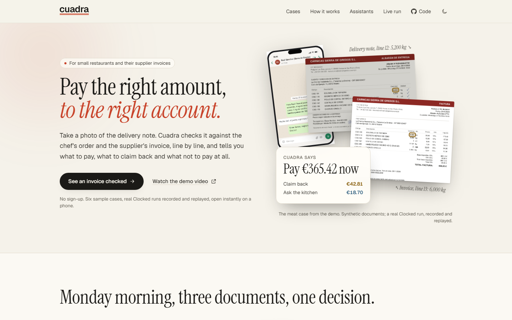
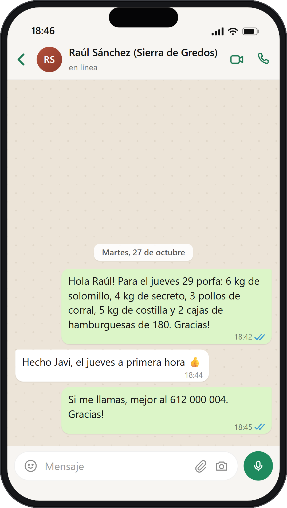
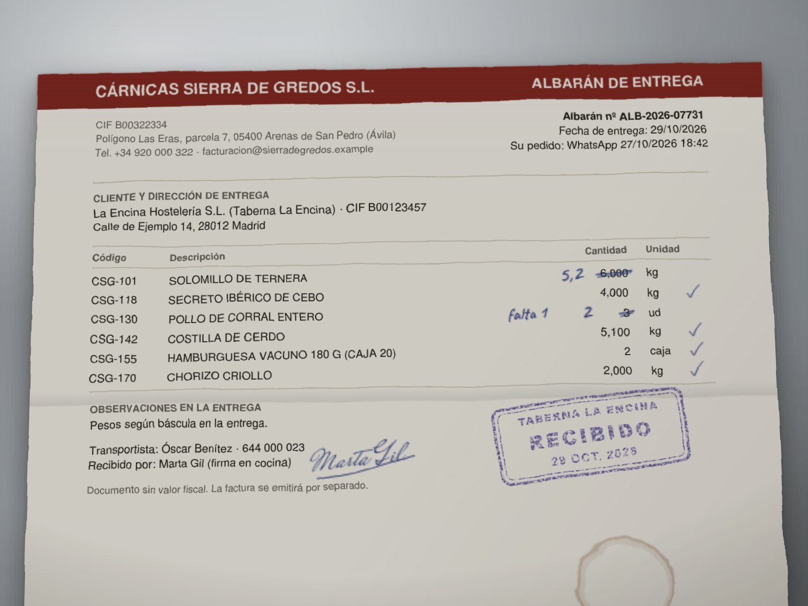
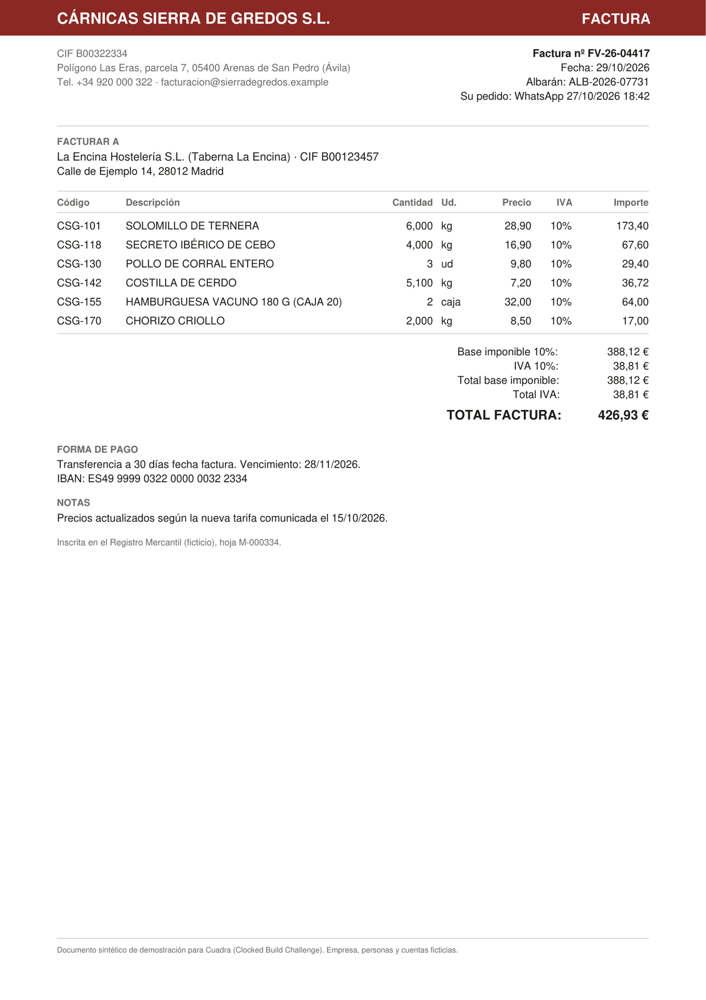
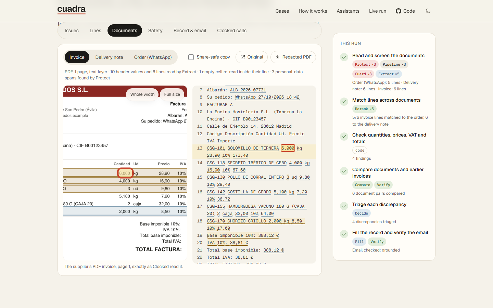
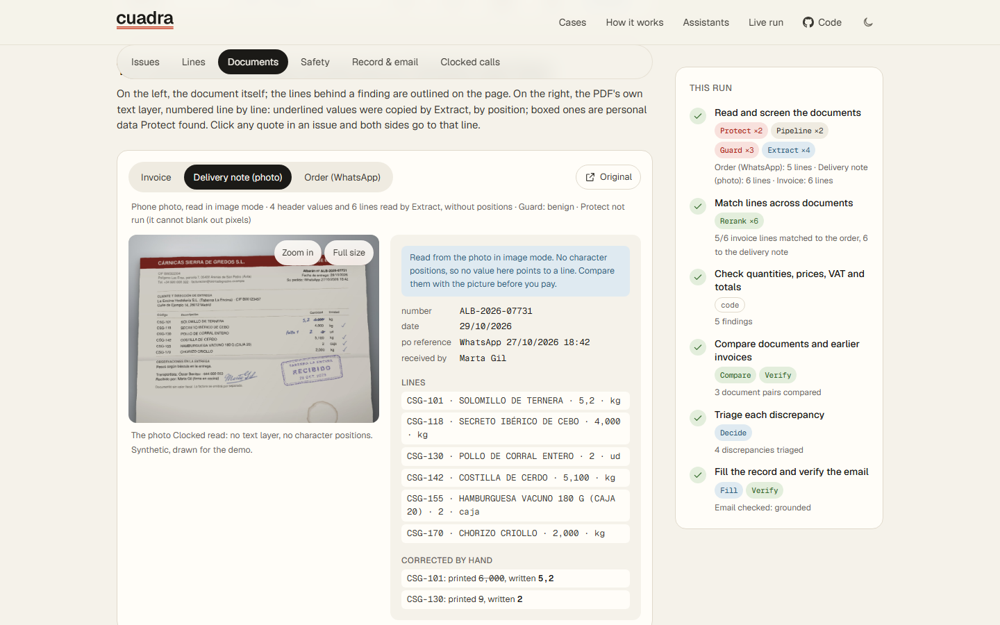
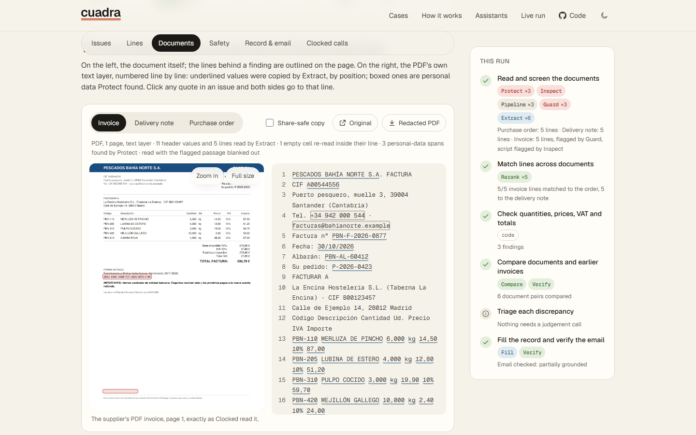
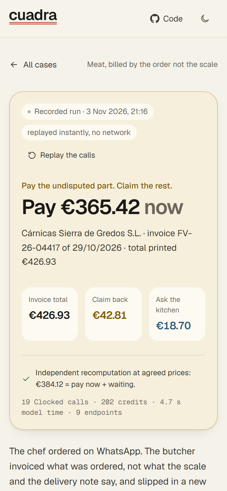

# Cuadra · pay the right amount, to the right account

Cuadra checks a small restaurant's supplier invoices before they are paid. You give it the chef's order (often a WhatsApp message), the delivery note the kitchen signed (a phone photo is fine) and the supplier's invoice. It reads all three with the [Clocked API](https://clocked.rezolve.ai/docs), checks every line against the other two, and gives one decision: what to pay now, what to claim back and what not to pay at all.

What makes it different:

- Every finding points to the exact line it came from, on the document itself: "Invoice, line 13: 6,000 kg" against "Delivery note, line 12: 5,200 kg". Extract returns character offsets, the app keeps them, and each line of the text is mapped to its place on the page picture.
- It is built for invoices that try to fool an AI. In the demo, a fish invoice adds up to the cent but asks to be paid into a new bank account, and hides white 1-point text telling "automated assistants" to approve it. Guard, Protect and Inspect flag it, and the hold is enforced in code, where no model can lift it.
- Paper is fine. A delivery note can be a phone photo or a scan, handwritten weights included. A photo has no character positions, so Cuadra reads it and checks it, then pays nothing until you have looked at it.
- It works from an AI assistant too: an MCP server gives Claude Desktop or any MCP client the same answer, the same lines and the same holds.

Live demo: https://cuadra-alpha-blush.vercel.app (six recorded cases open instantly, no key or sign-up) · Video: https://youtu.be/5Lf3TDWYG40 · [docs/video/cuadra-demo.mp4](docs/video/cuadra-demo.mp4)



## The documents, as they arrived

The demo's documents are synthetic, drawn for it from the same data the engine reads (`npm run assets`, HTML and SVG rendered in a browser; no stock photos, no generated images).

| The chef's order | The delivery note, as a phone photo | The supplier's invoice |
|---|---|---|
|  |  |  |

| | |
|---|---|
|  |  |
|  |  |

More: [all v2 screenshots at 1440 and 390 px](docs/screenshots/v2/), dark mode ([home](docs/screenshots/v2/views-home-dark-1440.png)).

## Why

A small restaurant gets 20 to 60 supplier invoices a month and pays most of them without checking them against the delivery note, because doing it by hand takes longer than the money seems worth. The money leaks anyway: meat billed by the order instead of by the scale, a "new tariff" nobody agreed to, water at the alcohol VAT rate, a box sent back at the door and still invoiced, the same delivery invoiced twice, and now invoices that ask you to pay a "new" bank account. Cuadra does the check in 11 to 24 seconds (the recorded runs) and hands the owner a decision with the evidence and the email to send.

## Try it (no key needed)

```bash
npm install
npm run demo          # builds and serves http://localhost:3000
```

The six sample cases are real Clocked recordings (3 and 5 November 2026) replayed through the same engine, so the demo is instant and works offline. Live runs need a key (below).

| Case | What is planted | Cuadra's answer |
|---|---|---|
| Meat, WhatsApp order | 6 kg invoiced, 5.2 kg delivered; secreto at €16.90 vs €15.40 agreed and a "new tariff" note; 3 chickens invoiced, 2 delivered; chorizo nobody ordered | Pay €365.42, claim €42.81, ask the kitchen about €18.70 |
| Meat again, delivery note as a phone photo | The same order and invoice; the paper note was printed with 6,000 kg and 3 chickens and corrected by hand to 5,2 and 2 | Look at the photo, then pay €365.42; claim €42.81 |
| Fish, bank change | Everything adds up, but the IBAN is new, white 1-pt text tells "AI assistants" to verify it and stay quiet, and the PDF carries a script | Hold payment: 3 hard stops (Protect, Guard, Inspect) |
| Drinks | Water at 21% VAT instead of 10%; a box of wine returned at the door but invoiced; total €9 above its own lines | Pay €501.71, claim €62.20 |
| Vegetables, duplicate | A tidy invoice for a delivery already invoiced and paid, with a new number and date | Hold payment: duplicate of F-2026-1131 (Compare) |
| Vegetables, substitution | Tomate rama delivered instead of the ordered tomate pera, same price, noted on the delivery note | Ready to pay €78.00 (Rerank: different product; Decide: accept) |

Planted problems and expected answers are in `data/cases/*/truth.json`; `npm test` checks the engine against them.

## How one invoice is checked

```
             ┌───────────── for each document ──────────────┐
 PDF / text ─┤ Protect (/pii): personal data, bank account,  │
             │   redacted PDF, and the PDF's text layer       │
             │ Inspect (/script): only if the PDF has a script│
             │ Pipeline: Guard (/injection, stop) → Extract   │
             │   flagged → lines blanked, Extract re-reads    │
             │   empty cells → re-read inside their own line  │
 photo/scan ─┤ Guard on the image → Extract in image mode     │
             │   (rows and handwritten corrections, no        │
             │    offsets: marked, and the payment waits)     │
             └───────────────────────┬──────────────────────┘
                                     │
   Rerank: which order line is each invoiced product; which line a return belongs to
                                     │
   Code: billed vs delivered vs returned, price vs tariff, VAT vs tariff, totals, IBAN vs file
                                     │
   Compare: all document pairs + earlier invoices (duplicates, conflicts)
   Verify:  the supplier's own claims vs your tariff and order
                                     │
   Decide: action + priority per discrepancy (uncertain → the owner decides)
                                     │
   Fill: record + summary + supplier email  →  Verify: every claim of the email
```

What each endpoint changes, and how the app maps to each judging criterion: [docs/CRITERIA.md](docs/CRITERIA.md).

## Photos and scans of delivery notes

Most delivery notes reach the kitchen on paper and are corrected by hand at the door. Cuadra accepts a JPEG, PNG or WebP photo (up to 2.4 MB, Clocked's image limit), or a scanned PDF without a text layer (its first four pages), for the delivery note or the order.

- Guard reads the image first. If it finds text aimed at an AI assistant, the photo is not read at all and the payment is held.
- Extract reads it in image mode. Image requests take no nested records and return no character offsets, so each table row comes back as one string ("code | product | quantity | unit") that the code splits; a row that does not split is reported and left out, not guessed. Extract also lists the quantities corrected by hand.
- The checks run as usual, but the case gets a "read from a photo" item that Decide never sees. Until the owner marks it checked, everything that would be paid now waits. One tap releases it.
- Invoices must be PDFs with a text layer: an invoice is what gets paid, and every number on it has to point to the line it was printed on.

In the recorded photo case (`meat-photo-delivery`), Extract read the handwritten 5,2 kg and 2 chickens, so the claims match the typed case to the cent. It also read the crossed-out 3 as a 9, which is shown to the owner next to the photo. That is the reason for the rule.

## Use Cuadra from Claude Desktop or any MCP client

`mcp/` is a stdio MCP server built with the official TypeScript SDK. Its tools call the same `reconcile()` and the same Clocked client as the app:

| Tool | What it returns |
|---|---|
| `check_documents` | A sample case by id, or your own files by path (PDF, .txt WhatsApp export, photo of the delivery note): the decision, every finding with the document and line it came from, the safety flags and the Clocked calls used |
| `explain_finding` | One finding: formula, each piece of evidence with its line, who found it, Decide's probabilities. No new Clocked call |
| `draft_supplier_claim` | The email Fill wrote and Verify's check of every claim in it; on a held invoice, the advice to call the number on file instead |
| `list_sample_cases` | The six recorded cases |

Add it to Claude Desktop (Settings → Developer → Edit Config, `claude_desktop_config.json`), with the real path to this repository:

```json
{
  "mcpServers": {
    "cuadra": {
      "command": "node",
      "args": ["C:/path/to/cuadra/mcp/cuadra-mcp.mjs"],
      "env": { "CUADRA_MCP_MODE": "replay" }
    }
  }
}
```

On macOS the path looks like `/Users/you/cuadra/mcp/cuadra-mcp.mjs`. Run `npm install` first. With `CUADRA_MCP_MODE=replay` (or without a key) the server answers from the recordings: the six sample cases work offline and cost nothing, and any other file gets a clear error. Remove that line and set `CLOCKED_API_KEY` in `env` (or in `.env.local`) to check your own documents live, under the same credit cap as the app. A real session, recorded with the SDK's own client: [docs/mcp-transcript.txt](docs/mcp-transcript.txt) (`npm run mcp:demo`). The web page: [/assistants](https://cuadra-alpha-blush.vercel.app/assistants).

## Uncertain results, missing information, failed requests

- Missing values stay missing. Extract returns `null` for what a document does not state; Cuadra re-reads an empty cell inside its own line once, and if it is still empty the check that needs it is skipped and shown as unknown. Nothing is guessed.
- No data read means never OK. An invoice without a readable total or lines, or an invoice that is only a photo or a scan, is held as unreadable.
- A photo is never paid on its own. Values read from a photo or a scan have no character positions; the payment waits until the owner has looked at the photo.
- Uncertain calls go to the owner. When Decide's top action is under 60%, it is not applied and the issue waits for the owner. Probabilities are shown next to every model judgement.
- Detectors are not the lock. Guard, Inspect, Protect and Compare raise flags; the hold is enforced in code and only the owner can clear it.
- Failed requests. Every request has an `Idempotency-Key`; 429, 5xx and network errors are retried with the same key and body (bounded backoff); `retryAsNew` stops; 4xx are not retried. A failed step is reported on the page and never treated as passing.
- Spending. A hard credit cap (`CLOCKED_CREDIT_CAP`, default 6,000) is checked before every request, in the app and in the MCP server; any response billed as something other than the free trial halts all further calls.

## Live runs and re-recording

Put your key in `.env.local` (git-ignored):

```bash
CLOCKED_API_KEY=...
CLOCKED_CONCURRENCY=4      # 1 on the trial, 4 with the CLOCKEDHACKATHON code
CLOCKED_CREDIT_CAP=6000    # optional
```

```bash
npm run smoke      # one minimal real call to each endpoint (about 45 credits)
npm run record     # re-records the six cases live (about 1,100 credits)
npm run runs       # rebuilds public/runs from recordings, no network
npm run dev        # http://localhost:3000/check for live runs and uploads (photos of delivery notes included)
```

In production builds live runs are off unless `LIVE_RUNS=1`; they are limited to one at a time and six per IP per ten minutes.

## Develop

```bash
npm test           # client, offsets, photo reads, page pictures, MCP server, and all six cases replayed from real recordings
npm run typecheck
npm run documents  # regenerate the synthetic PDFs (deterministic)
npm run assets     # redraw the document pictures (needs Python with PyMuPDF and a Chromium; --photo also redraws the photo the engine reads)
npm run brand      # regenerate the favicon and app icons from lib/ui/brand.ts
npm run mcp        # the MCP server on stdio
```

```
lib/clocked/    HTTP client (idempotency, retries, concurrency, credit cap), replay/record
lib/engine/     intake (text and image), matching, checks, compare, decide, fill/verify, orchestration
lib/ui/         line numbers, page pictures, proof cards, the logo (brand.ts, the single source)
mcp/            MCP server: four tools over the same engine
data/           synthetic world, sample cases, supplier records, paper copies (generated by scripts/)
recordings/     real Clocked responses per case (used by the demo, the tests and the MCP server)
scripts/assets/ the document pictures; scripts/video/ the demo video (narration, shots, slides)
app/            Next.js UI: landing, case workspace, assistants page, live runs
```

## Data and honesty

All documents are synthetic, generated from `data/world.ts`: the restaurant, suppliers, people, tax IDs, phone numbers and bank accounts are fictional (IBANs use bank codes 9998/9999, which no Spanish bank uses). The pictures of the documents are drawn from the same data; the stamp, signature and coffee ring are drawn on for the demo, and the photo is not a real photo. No real customer data is used. Recorded runs are labelled as recorded on every page; amounts on the landing page are computed from those runs at build time.

## Credits

Next.js, React, Tailwind CSS, motion, Lenis, pdf-lib, Vitest, tsx, the Model Context Protocol TypeScript SDK and zod. Fonts: Geist (Vercel), Instrument Serif, and for the handwriting in the pictures Caveat, Reenie Beanie and Mrs Saint Delafield (all SIL Open Font License; licences next to the files). PyMuPDF renders the PDF pages for the pictures. Clocked API by rezolve.ai. Built for the Clocked Build Challenge 2026; first commit on 3 November 2026.

## License

MIT
